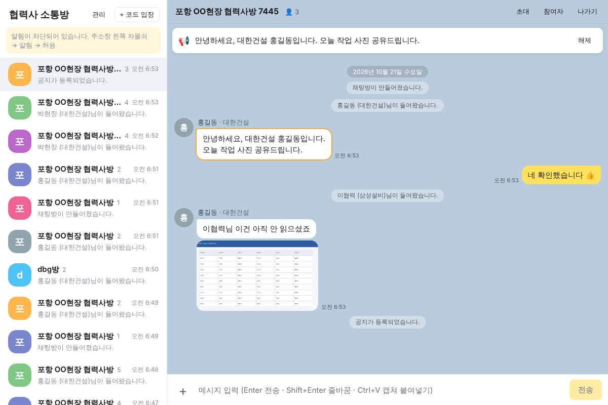
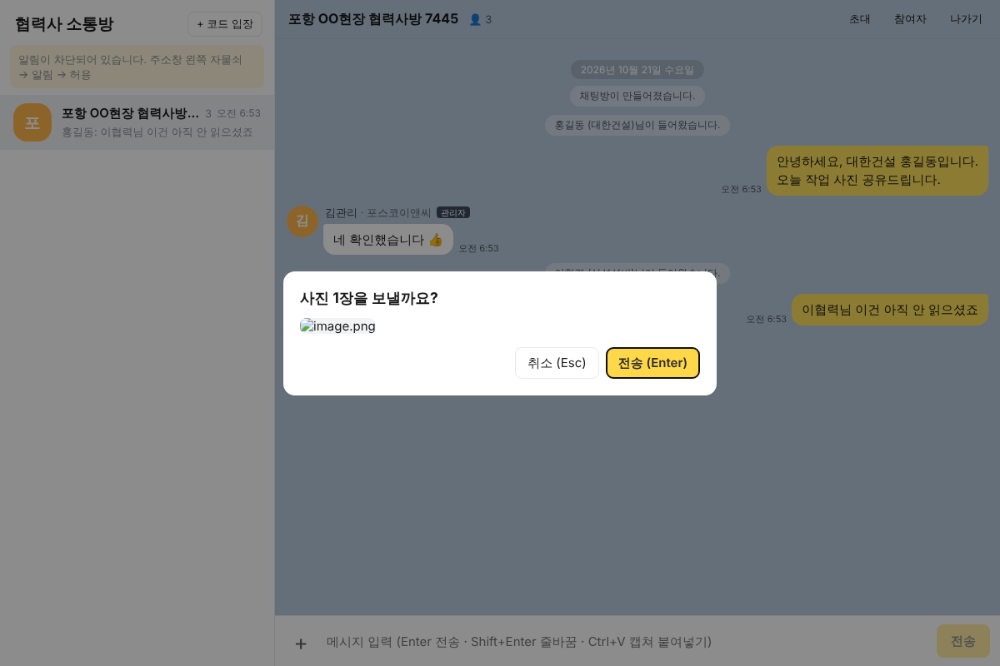
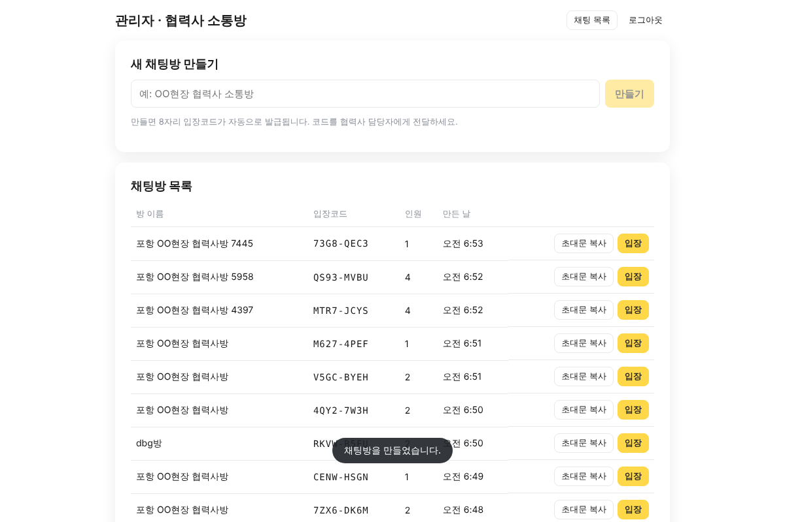
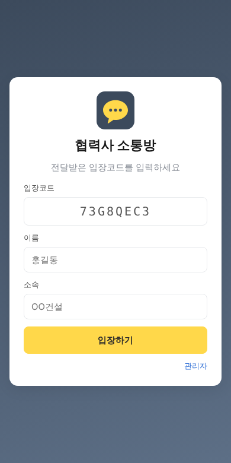
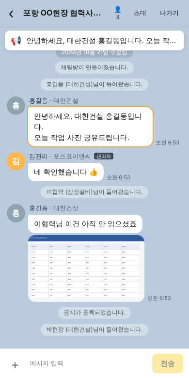
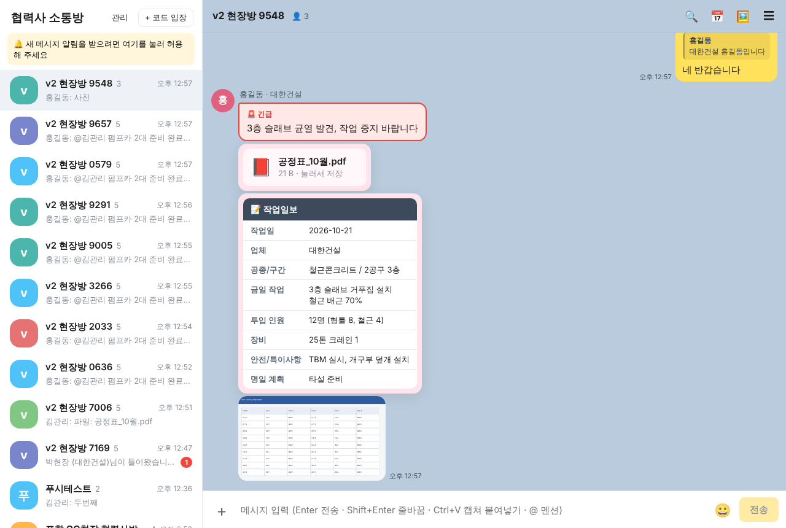
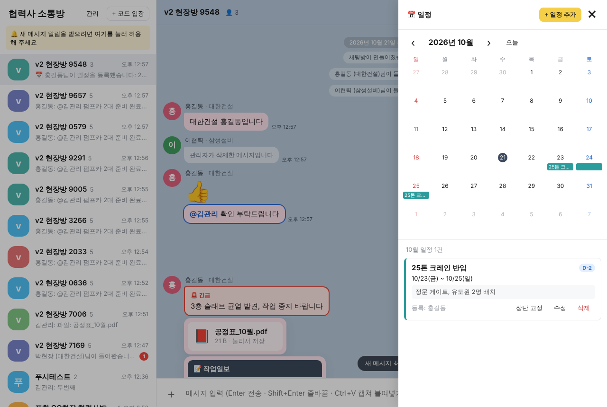
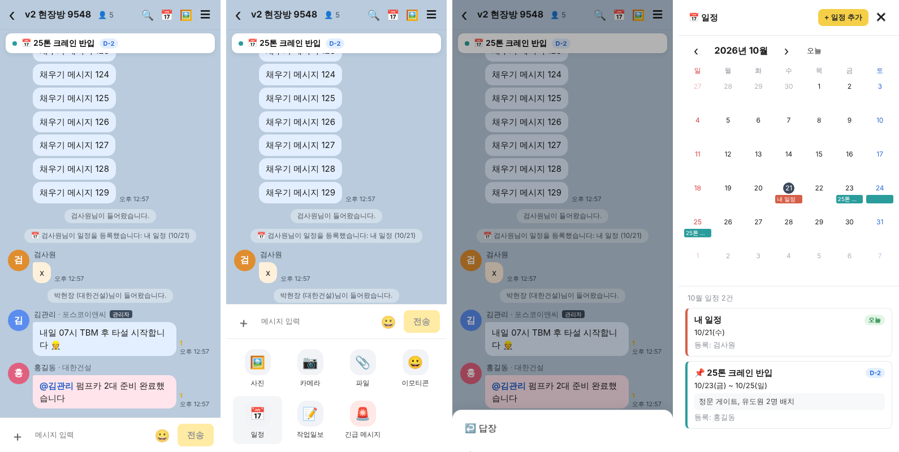

# 협력사 소통방 (po3)

카카오톡 PC버전을 설치할 수 없는 환경에서, **브라우저만으로** 협력사 관리자들과 대화하는 카톡형 웹 메신저입니다.
무료 서비스(Supabase + Cloudflare Pages)만으로 운영합니다.

## 주요 기능

- **입장코드로만 입장**: 관리자가 방을 만들면 8자리 코드(예: `ABCD-2345`)가 발급됩니다. 코드를 모르면 방을 찾을 수도, 볼 수도 없습니다.
- **카톡 같은 채팅 화면**: 말풍선, 이름·소속 표시, 날짜 구분선, 링크 자동 연결
- **캡쳐 바로 붙여넣기**: `Win + Shift + S`로 캡쳐한 뒤 채팅창에서 `Ctrl + V` → 확인 후 `Enter`로 전송
- **사진 전송**: `+` 버튼, 드래그&드롭, 여러 장 한 번에 보내기. 전송 전에 자동으로 압축합니다(캡쳐 속 글씨는 선명하게 유지).
- **읽음 숫자**: 메시지 옆에 아직 안 읽은 사람 수 표시
- **공지 고정**: 관리자가 메시지를 우클릭(모바일은 길게 누르기)하면 → `공지로 등록`
- **새 메시지 알림**: 브라우저 알림, 탭 제목에 안 읽은 수 표시
- **모바일 지원**: 휴대폰 브라우저에서도 같은 주소로 사용
- **앱처럼 설치 가능**: Chrome/Edge 주소창의 "앱 설치" 버튼 → 바탕화면 아이콘, 별도 창 (관리자 권한 불필요)
- **보관 정책**: 사진·파일은 90일 뒤 자동 삭제, 대화는 영구 보관

### v2 추가 기능
- **📅 일정 달력**: 시작일~종료일 일정 등록 (모든 참여자). 관리자가 **상단 고정**하면 채팅방 위에 `D-2` 형태로 표시
- **길게 누르기 / 우클릭 메뉴**: 답장 · 복사 · 일정으로 등록 · 공지 등록 · 삭제 (본인 메시지, 관리자는 전체)
- **`+` 메뉴**: 사진 · 카메라 · 파일 · 이모티콘 · 일정 · 작업일보 · 긴급 메시지
- **🚨 긴급 메시지**: 빨간 강조, 알림이 사라지지 않고 화면에 남음
- **📎 파일 첨부**: PDF, 엑셀, 한글, 도면 등 (20MB까지)
- **📝 작업일보**: 작업일·업체·공종·작업내용·인원·장비·안전사항·명일계획 양식 → 표로 표시
- **@멘션**: `@`를 입력하면 참여자 목록이 뜨고, 지정된 사람에게 강조 표시와 알림
- **사람별 말풍선 색**, 이모티콘만 보내면 크게 표시
- **🖼️ 사진·파일 모아보기**, **🔍 대화 검색** (결과를 누르면 그 대화로 이동)
- **푸시 알림**: 사이트를 닫아도 PC 화면 구석과 휴대폰에 알림 (아이폰은 홈 화면에 추가한 경우)

## 화면

| PC 채팅 | 캡쳐 붙여넣기 (Ctrl+V) |
|---|---|
|  |  |

| 관리자 | 모바일 입장 | 모바일 채팅 |
|---|---|---|
|  |  |  |

### v2 화면

| 긴급 · 파일 · 작업일보 · 답장 | 일정 달력 |
|---|---|
|  |  |



## 사용 흐름

```
관리자: #/admin 로그인 → 방 만들기 → [초대문 복사] → 협력사에 전달
참여자: 접속주소 열기 → 입장코드 + 이름 + 소속 입력 → 입장
```

## 구성

| 구분 | 사용 서비스 (무료) | 역할 |
|---|---|---|
| 화면 | Cloudflare Pages | 웹사이트 호스팅 |
| DB | Supabase Postgres | 방·참여자·메시지 저장, 행 단위 보안(RLS) |
| 실시간 | Supabase Realtime | 메시지·읽음·공지 즉시 전달 |
| 사진 | Supabase Storage (비공개) | 방 참여자만 열람 가능 |
| 푸시 | Supabase Edge Functions | 새 메시지 푸시 알림 발송 (`supabase/functions/push`) |
| 정리 | GitHub Actions (매일) | 90일 지난 사진·파일 삭제 + 프로젝트 일시정지 방지 |

설치·배포 방법은 **[docs/SETUP.md](docs/SETUP.md)** 를 보세요.

## 폴더 구조

```
supabase/migrations/   DB 스키마 (SQL Editor에 붙여넣기)
src/pages/             입장 / 관리자 / 메신저 화면
src/components/        채팅방, 말풍선, 입력창, 사진 뷰어 등
src/lib/               Supabase 연결, 실시간, 이미지 압축, 알림
scripts/               오래된 사진 정리 스크립트
```

## 개발

```bash
npm install
cp .env.example .env.local   # Supabase 주소/키 입력
npm run dev
```

로컬 Supabase(Docker 필요)로 테스트하려면 `npx supabase start`를 실행하세요. `supabase/migrations`가 자동으로 적용됩니다.

---

## 엑셀 바차트 공정표 자동 작성

같은 저장소의 [`excel-barchart/`](excel-barchart/) 폴더에 엑셀 VBA 바차트(공정표) 자동 작성 도구가 있습니다. 사용법은 해당 폴더의 README를 보세요.
