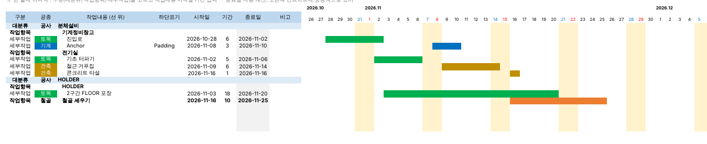
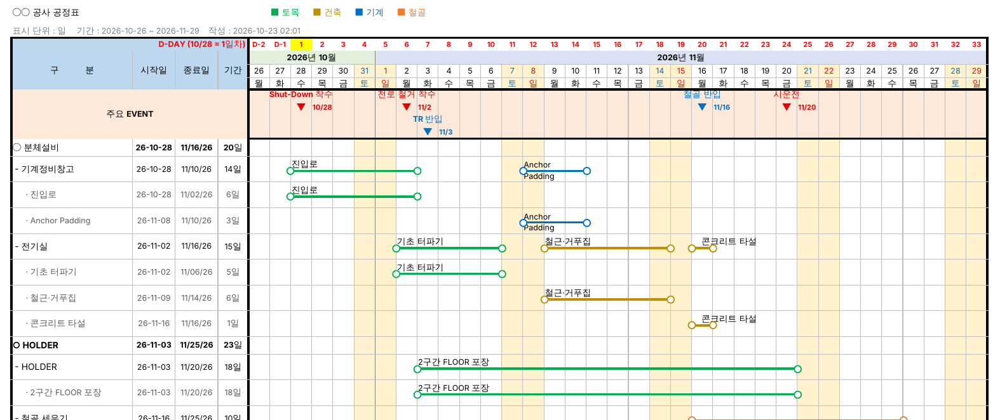

# 엑셀 BAR CHART 공정표 자동 작성 (초안 v0.6.1)

작업입력 시트에서 일정을 입력·조정하면 **오른쪽에 공종색 간트차트가 바로** 그려지고,
[바차트 생성]을 누르면 엑셀에 손으로 그리던 **보고용 바차트 공정표**(칸 아래선 굵게 + 시작·종료 원, D-DAY, 주요 이벤트 ▼)를 자동으로 만들어 주는 엑셀 매크로입니다.

**작업입력 시트 (작업·조정용)**



**바차트 시트 (보고용)**



> 미리보기는 LibreOffice로 렌더링한 그림이라 Excel 화면과 조금 다릅니다. Excel에서는 바 위 글자가 바 가운데로 정렬되고 글꼴 크기도 설정대로 표시됩니다.

## 받는 방법 (둘 중 하나)

### 방법 A. 매크로 포함 파일 바로 쓰기 (권장)
1. [`download/바차트_자동작성.xlsm`](download/) 을 내려받습니다.
2. 인터넷에서 받은 파일은 Windows가 매크로를 막습니다. **파일 오른쪽 클릭 → 속성 → 아래쪽 `차단 해제` 체크 → 확인**
3. 파일을 열고 노란 줄의 **[콘텐츠 사용]** 을 누르면 초기 설정이 자동으로 실행되어 `메인 / 작업입력 / 공종 / 주요일정 / 공휴일` 시트가 만들어집니다.
   (자동으로 안 되면 `시작` 시트의 **[초기 설정]** 버튼)

### 방법 B. 모듈 가져오기 (방법 A 파일이 안 열릴 때)
1. [`download/BarChart.bas`](download/) 를 내려받습니다. (한국어 Windows 용으로 저장되어 있음)
2. 엑셀 새 통합 문서 → `Alt + F11` (VBA 편집기) → **파일 → 파일 가져오기** → `BarChart.bas`
3. 왼쪽 프로젝트 창의 **ThisWorkbook** 을 더블클릭하고 [`download/ThisWorkbook_코드.txt`](download/) 내용을 붙여 넣습니다.
   (이게 있어야 바차트 시트에서 고친 내용이 바로 반영됩니다)
4. VBA 편집기를 닫고 `Alt + F8` → **SetupWorkbook** 실행
5. **다른 이름으로 저장 → `Excel 매크로 사용 통합 문서 (*.xlsm)`**

## 사용 방법

1. **[작업입력]** 시트에 **한 줄에 하나씩** 입력합니다. (빈칸 없이 위에서 아래로)

   | 구분 | 공종 | 작업내용 (선 위) | 하단표기 | 시작일 | 기간 | 종료일 |
   |---|---|---|---|---|---|---|
   | 대분류 | 공사 | 분체설비 | | | | |
   | 작업항목 | | 기계정비창고 | | | | |
   | 세부작업 | 토목 | 진입로 | | 2026-10-28 | 6 | *(수식)* |
   | 세부작업 | 기계 | Anchor | Padding | 2026-11-08 | 3 | *(수식)* |
   | 작업항목 | 철골 | 철골 세우기 | | 2026-11-16 | 10 | *(수식)* |

   - **구분**은 목록에서 고릅니다(대분류 / 작업항목 / 세부작업). 세부작업은 바로 위 작업항목, 작업항목은 바로 위 대분류에 속하고, 작업내용은 단계에 맞춰 자동으로 들여쓰기됩니다.
   - **공종**도 목록에서 고릅니다. 비워 두면 위 단계(작업항목 → 대분류)의 공종을 따릅니다.
   - **종료일은 수식 `=시작일+기간-1`** 이 미리 들어 있습니다. 종료일을 직접 입력하면(수식을 덮어쓰면) 기간이 다시 계산되고 종료일은 수식으로 돌아갑니다.
   - **대분류·작업항목 줄의 날짜는 자동**입니다: 아래 작업들의 최초 시작일 ~ 최종 종료일로 채워지고(남색 글자) 간트에 전체 막대로 표시됩니다.
     (아래에 날짜 있는 작업이 없는 작업항목은 직접 입력한 날짜가 그대로 쓰입니다)
   - 오른쪽 간트차트(월 / 일 / 요일 머리글)에 **공종색 막대**가 바로 칠해지고, **막대 가운데에 작업내용**이 표시됩니다(막대보다 길면 막대 오른쪽). 주말·공휴일은 연노랑, 오늘은 연분홍.
   - 공종 이름·색은 **[공종]** 시트에서 바꿉니다(B열 칸의 채우기 색). 색을 바꾼 뒤에는 **[색상 적용]** 버튼을 누르세요.
2. **[메인]** 시트에서 표시 단위(**일 / 주 / 10일 / 월**)를 고르고 **[바차트 생성]** 을 누릅니다.
3. `바차트_일`, `바차트_주` … 처럼 단위별 시트가 만들어집니다.
4. **[세부작업 접기]** (또는 시트 왼쪽의 `-` 버튼)를 누르면 세부작업 행이 숨겨지고,
   작업항목 줄에 세부작업 바들만 가로로 남습니다. (캡쳐 속 "기계정비창고" 줄과 같은 모양)
   접어도 표 맨 아래 굵은 선은 그대로 남고, 인쇄 영역은 표까지만(아래 안내 행 제외) 잡혀 있어 바로 출력할 수 있습니다.
5. **바차트 시트에서 바로 고치기**: 왼쪽 `구분 / 시작일 / 종료일 / 기간` 칸을 고치면 작업입력 시트에 반영되고 바가 즉시 다시 그려집니다.

   | 고친 칸 | 결과 |
   |---|---|
   | 세부작업 행의 시작일 | 기간은 그대로, 종료일이 함께 이동 (일정 이동) |
   | 세부작업 행의 종료일 | 기간 다시 계산 |
   | 세부작업 행의 기간 | 종료일 다시 계산 |
   | 구분(이름) | 세부작업명 / 작업항목명 / 대분류명 변경 |
   | 작업항목 줄의 날짜 | 날짜가 있는 작업이 없으면 작업항목 자체에 입력, 하나뿐이면 그 작업을 변경, 여러 개면 안내 후 원래대로 |
   | 대분류 줄의 날짜 | 아래 작업들을 합친 값이라 입력 불가 (안내 후 원래대로) |
   | 날짜가 빈 작업 | 기간만 먼저 넣어도 저장되고, 시작일을 넣으면 종료일이 계산됨. 종료일만 넣으면 기간(없으면 1일)으로 시작일 계산 |

   바차트 시트의 종료일 칸에도 `=시작일+기간-1` 수식이 들어 있습니다.
6. **바차트 시트에서 새 작업 추가**: 표 바로 아래 회색 안내 행(`↓ 새 작업 입력 …`)이나 그 아래 빈 행, 또는 행 삽입으로 끼워 넣은 빈 행에 입력하면 작업입력에 추가되고 바로 그려집니다.

   | 구분 칸에 입력 | 추가되는 위치 |
   |---|---|
   | `용접` (기호 없이) | 바로 위 작업항목의 **세부작업** (바로 위가 세부작업이면 그 다음) |
   | `- 배관 지지대` | 바로 위 대분류의 **작업항목** (그 대분류의 맨 끝) |
   | `* 배관설비` 또는 `○ 배관설비` | 새 **대분류** (맨 끝) |

   시작일·기간(또는 종료일)도 같은 행에 함께 넣을 수 있고, 여러 행을 한 번에 붙여 넣어도 위에서부터 차례로 추가됩니다.
   작업을 **삭제**하는 것은 작업입력 시트에서 해 주세요. (바차트에서 행을 지우면 다시 그릴 때 되살아남)
7. 자동 반영이 안 될 때는 메인이나 작업입력 시트의 **[바차트 생성]** 을 다시 누르세요.
8. **새 버전 파일로 옮길 때**: 새 파일의 메인 시트 **[이전 파일에서 가져오기]** → 이전 파일 선택.
   작업입력·메인 설정·공종·주요일정·공휴일이 복사됩니다. **v0.4 이전 양식(대분류/작업항목/세부작업 3칸)은 새 양식으로 자동 변환**됩니다.
   (두 파일 이름이 같으면 엑셀이 동시에 못 열기 때문에 이전 파일 이름을 바꿔 주세요)
9. **주요 이벤트**: 메인 시트 **[주요 이벤트 추가]** (날짜 → 내용 → 색상 입력) 또는 **[주요일정]** 시트에 직접 입력하면
   바차트 날짜 아래에 **▼ 화살표 + 날짜 + 내용**으로 표시됩니다. 글자가 겹치면 아랫단으로 내려갑니다.
10. **D-DAY**: 메인 시트 **D-DAY 기준일**(예: SD 착수일)을 넣으면 날짜 위에 `D+1, D+2 …` 줄이 생깁니다(기준일 = D+1, 그 전날부터 D-1, D-2 …).

   - 작업입력 시트를 고친 경우에는 바차트 시트로 돌아가는 순간 자동으로 다시 그려집니다.
   - 다시 그려도 화면 위치·선택 칸·접기 상태는 유지됩니다. (단, 엑셀 실행 취소(Ctrl+Z)는 되지 않습니다)

### 메인 시트 설정

| 항목 | 설명 |
|---|---|
| 공사명 | 바차트 제목 (`○○ 공사 공정표`) |
| 표시 단위 | 일 / 주 / 10일 / 월 |
| 차트 시작일·종료일 | 비우면 작업 일정에 맞춰 자동 |
| 기준일 (빨간 세로선) | 입력하면 그 날짜 오른쪽에 빨간 굵은 세로선 |
| 세부작업 행 | 펼침 / 접힘 (생성 직후 상태) |
| 시작·종료·기간 열 | 표시 / 숨김 |
| 기간 칸 너비 | 비우면 자동 (일 3.6 / 주 6.3 / 10일 7 / 월 9) |
| 바 글자 크기 | 기본 9. 바 위/아래 글자가 공간보다 길면 자동으로 최소 6까지 줄어듦 |
| D-DAY 기준일 | SD 착수일 등. 입력하면 날짜 위에 D+1, D+2 … 줄 표시 |
| 바 색상 | 검정 / 공종색 (공종색이면 선·원을 공종 색으로, 제목 옆에 범례) |
| 주요 이벤트 | 표시 / 숨김 |

## 결정사항 (초안 기준 — 바꾸고 싶은 것은 말씀해 주세요)

1. **엑셀 VBA 매크로**로 만들었습니다. 설치 프로그램 없이 회사 PC 엑셀만으로 동작합니다.
2. **입력 시트와 차트 시트를 분리**했고, 원본은 작업입력 시트입니다. 바차트 시트 왼쪽 칸을 고치면 작업입력에 반영한 뒤 다시 그립니다. 바(날짜 칸) 영역에 직접 그리거나 쓴 것은 다시 그릴 때 지워집니다.
3. **3단계 구조**: 작업입력은 한 줄 = 한 작업(구분 + 작업내용 한 칸). 바차트에서는 `○ 대분류`(1행) → `- 작업항목`(2행) → `· 세부작업`(2행).
   작업항목 줄에는 그 아래 세부작업 바가 **모두 모여서** 표시되고, 세부작업 행은 그룹(접기/펼치기)으로 묶입니다.
4. 한 작업 줄은 **2행**(선 위 행 + 선 아래 행)이고, 바는 **선 위 행의 아래 테두리(굵게)** 로 그립니다. 세부작업명은 선 위, 하단표기는 선 아래에 씁니다.
5. 시작·종료 **원은 도형**(흰 바탕 검은 테두리)이며, 시작일 칸의 왼쪽 경계와 종료일 칸의 오른쪽 경계에 놓입니다. 행을 숨기면 원도 같이 숨겨집니다.
6. **주 / 10일 / 월 단위도 내부적으로는 하루 = 1열**로 그리고 머리글만 묶었습니다. 그래서 단위를 바꿔도 시작·종료 위치가 날짜에 정확히 맞습니다.
   - 주: 월요일 시작, 머리글은 `10/26`·`1주`, 목요일이 속한 달로 묶음
   - 10일: 상순(1~10) / 중순(11~20) / 하순(21~말일)
7. 날짜 머리글: **토요일 파랑, 일요일·공휴일 빨강**, 일 단위에서는 주말·공휴일 칸에 연노랑 배경.
8. **공휴일**은 `공휴일` 시트에 2026~2027년을 미리 넣었습니다(대체공휴일·2026 지방선거 포함). 제헌절·노동절 등 변경 사항은 확인 후 직접 추가하세요.
9. 기간 계산은 **달력일 기준(시작일·종료일 포함)** 입니다. **종료일 = 시작일 + 기간 - 1 수식**이고, 종료일을 직접 입력하면 기간을 다시 계산한 뒤 수식으로 되돌립니다.
10. 기준일 빨간 세로선은 선택 사항입니다(비우면 없음). 캡쳐처럼 매주 빨간 선이 필요하면 알려 주세요.
11. 바차트 시트에서 **시작일을 바꾸면 기간을 유지한 채 일정이 이동**합니다(MS Project 방식). 종료일·기간을 바꾸면 서로 다시 계산합니다.
12. 바차트에서 새 작업을 입력하면 **기호로 단계를 구분**합니다(없음=세부작업, `-`=작업항목, `*` 또는 `○`=대분류). 대분류·작업항목은 그 묶음의 맨 끝에 추가됩니다.
13. **바 글자 배치**: 바 안에 들어가면 가운데, 길면 바 시작점부터 다음 바 앞까지 왼쪽 정렬로 쓰고 필요하면 글자를 줄입니다(최소 6). 그래도 넘치는 부분은 다음 글자 앞에서 잘립니다.
14. **작업입력 간트**는 조건부 서식(1일 = 1칸, 400일)으로 그립니다. 시작일은 메인의 차트 시작일, 비우면 최초 시작일이 있는 주의 월요일.
15. 대분류·작업항목 날짜는 아래 작업 범위로 **자동 계산**되어 작업입력 간트에 전체 막대로 표시됩니다(직접 고쳐도 다시 계산됨). 보고용 바차트의 대분류 줄은 그 범위를 글자로만 표시합니다(바 없음).
16. 주요 이벤트 ▼는 도형이 아니라 **글자(▼)** 라서 인쇄·복사에도 그대로 나옵니다. 두 단을 넘게 몰리면 글자를 작게(7pt) 표시합니다.

## 알려진 한계 / 다음 단계 후보

- 같은 작업항목의 세부작업 기간이 겹치면 요약 줄에서 원이 겹칩니다.
- 진행률(실적) 표시, 계획/실적 2줄, 매주 빨간 선, 인쇄 머리글(결재란) 등은 아직 없습니다.

## 폴더 구성

```
excel-barchart/
├─ src/BarChart.bas        VBA 소스 (UTF-8, 이 파일을 고칩니다)
├─ download/               배포 파일 (tools/build.py 로 생성)
│   ├─ 바차트_자동작성.xlsm
│   ├─ BarChart.bas        가져오기용 (CP949)
│   └─ ThisWorkbook_코드.txt  가져오기 때 ThisWorkbook 에 붙여 넣을 이벤트 코드
├─ tools/
│   ├─ build.py            xlsm / bas 생성
│   ├─ vba_bin.py          vbaProject.bin 생성기 (Excel 없이 VBA 넣기)
│   ├─ lo_run.py           LibreOffice 로 매크로 실행·PDF 출력 (테스트용)
│   └─ tests/              edit_test.vba (바차트 직접 수정), import_test.vba (이전 양식 변환)
└─ docs/                  미리보기 그림
```

개발용 명령:

```bash
pip install xlsxwriter
python3 excel-barchart/tools/build.py                       # download/ 갱신
python3 excel-barchart/tools/lo_run.py /tmp/out 일 주 10일 월  # LibreOffice 로 실행해 결과 PDF 확인
```
