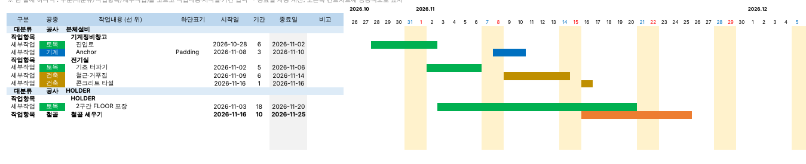
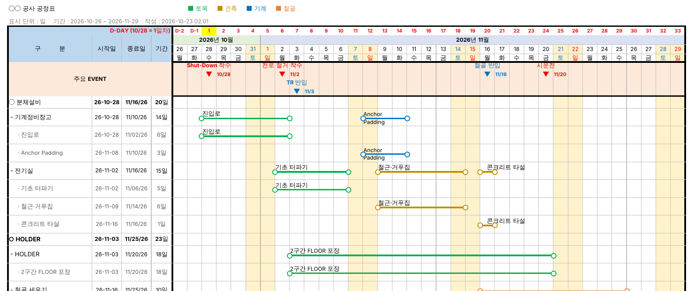
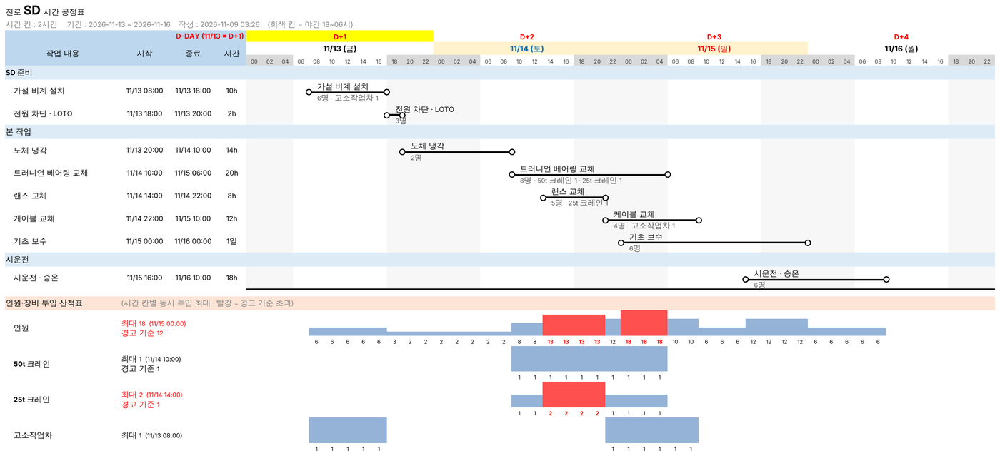
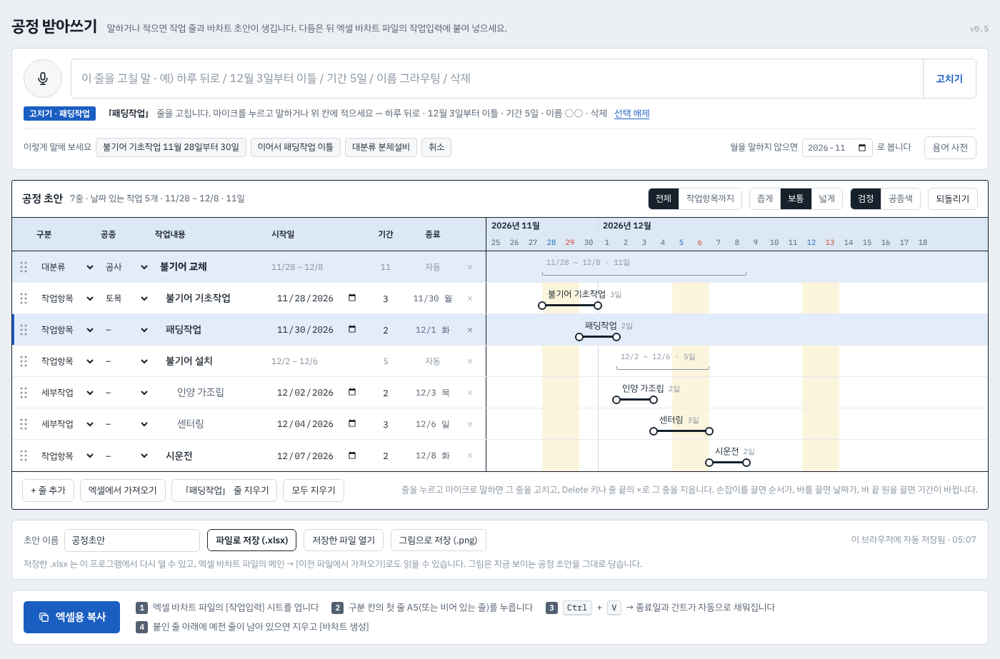
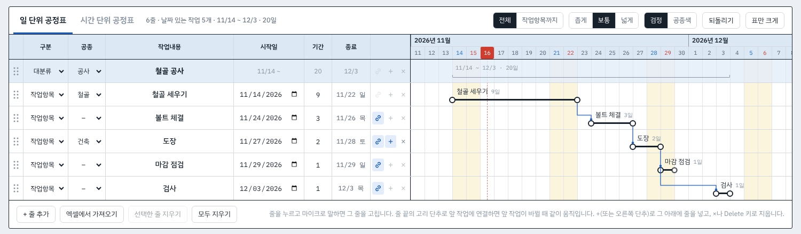
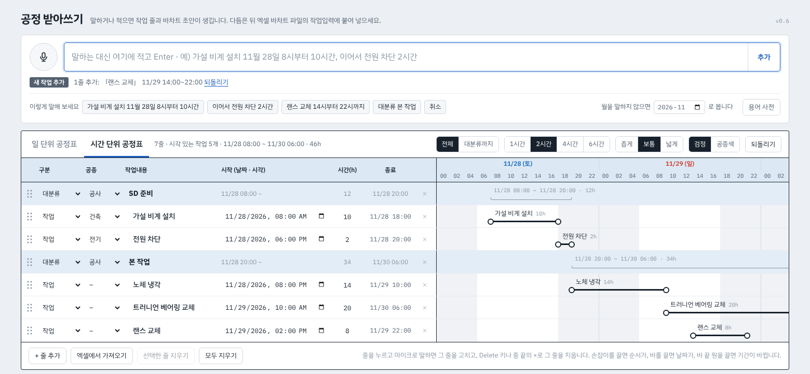

# 엑셀 BAR CHART 공정표 자동 작성 (초안 v0.7.8 / 시간공정표판 v0.8.5 / 공정 받아쓰기 v0.9)

작업입력 시트에서 일정을 입력·조정하면 **오른쪽에 공종색 간트차트가 바로** 그려지고,
[바차트 생성]을 누르면 엑셀에 손으로 그리던 **보고용 바차트 공정표**(칸 아래선 굵게 + 시작·종료 원, D-DAY, 주요 이벤트 ▼)를 자동으로 만들어 주는 엑셀 매크로입니다.

**작업입력 시트 (작업·조정용)**



**바차트 시트 (보고용)**



> 미리보기는 LibreOffice로 렌더링한 그림이라 Excel 화면과 조금 다릅니다. Excel에서는 바 위 글자가 바 가운데로 정렬되고 글꼴 크기도 설정대로 표시됩니다.

**시간공정표 + 직종별 인원·장비 산적표 + 누적 공수 (v0.8.1, 별도 시트)**



**공정 받아쓰기 (v0.9, 말로 초안 만들기 → 엑셀에 붙여넣기)**



> **사용설명서**: [`download/바차트_사용설명서.html`](download/) 를 내려받아 브라우저로 여세요. (버튼 그림과 활용 방법 정리)

## 받는 방법 (둘 중 하나)

### 내려받을 파일 (파일 이름 = 버전 + 바뀐 내용)

| 파일 | 내용 |
|---|---|
| `바차트_v0.7.8_종료일수식수정.xlsm` | 바차트 기본판 (일 단위). 바차트에서 날짜를 고치면 작업입력 종료일이 비던 문제 수정 (v0.7.7 입력 순서 유지, v0.7.6 속도 개선 포함) |
| `바차트_v0.8.5_종료일수식수정.xlsm` | 기본판 + **[시간입력] / [시간공정표]** 시트 (시간 단위 SD 공정, 직종별 인원·장비 산적표, 누적 공수 선그래프). 속도 개선 포함 |
| `공정받아쓰기_v0.9_공정내장지원.html` | 말로 공정 초안을 만들어 엑셀에 붙여 넣는 프로그램 (Chrome / Edge 로 열기). 일 단위 · 시간 단위 두 탭, 줄·칸을 골라 말로 고치기, 접어 보기, 한 줄씩 지우기, 엑셀에서 가져오기, 파일·그림으로 저장 |
| `바차트_v0.7.3_…` ~ `바차트_v0.7.7_…`, `바차트_v0.8_…` ~ `바차트_v0.8.4_…`, `공정받아쓰기_v0.1_…` ~ `공정받아쓰기_v0.8_…` | 이전 버전 (그대로 보관) |
| `TimeChart.bas` | 쓰던 v0.7.x 파일에 시간 기능만 추가할 때 (아래 방법 C) |

### 방법 A. 매크로 포함 파일 바로 쓰기 (권장)
1. [`download/`](download/) 에서 위 xlsm 중 하나를 내려받습니다.
2. 인터넷에서 받은 파일은 Windows가 매크로를 막습니다. **파일 오른쪽 클릭 → 속성 → 아래쪽 `차단 해제` 체크 → 확인**
3. 파일을 열고 노란 줄의 **[콘텐츠 사용]** 을 누르면 초기 설정이 자동으로 실행되어 `메인 / 작업입력 / 공종 / 주요일정 / 구역일정 / 공휴일` 시트가 만들어집니다.
   (v0.8 파일은 `시간입력 / 시간공정표` 시트도 함께 만들어집니다. 자동으로 안 되면 `시작` 시트의 **[초기 설정]** 버튼)

### 방법 B. 모듈 가져오기 (방법 A 파일이 안 열릴 때)
1. [`download/BarChart.bas`](download/) 를 내려받습니다. (한국어 Windows 용으로 저장되어 있음)
2. 엑셀 새 통합 문서 → `Alt + F11` (VBA 편집기) → **파일 → 파일 가져오기** → `BarChart.bas`
3. 왼쪽 프로젝트 창의 **ThisWorkbook** 을 더블클릭하고 [`download/ThisWorkbook_코드.txt`](download/) 내용을 붙여 넣습니다.
   (이게 있어야 바차트 시트에서 고친 내용이 바로 반영됩니다)
4. VBA 편집기를 닫고 `Alt + F8` → **SetupWorkbook** 실행
5. **다른 이름으로 저장 → `Excel 매크로 사용 통합 문서 (*.xlsm)`**

### 방법 C. 쓰던 파일에 시간공정표만 추가 (v0.8.1)
1. 쓰던 파일에서 `Alt + F11` → **파일 → 파일 가져오기** → [`download/TimeChart.bas`](download/) (v0.8 TimeChart 모듈이 있으면 먼저 제거)
2. `Alt + F8` → **SetupTimeSheets** 실행 → `시간입력 / 시간공정표` 시트 추가 (기존 시트는 그대로)
3. (선택) ThisWorkbook 코드를 [`download/ThisWorkbook_코드_v0.8.txt`](download/) 로 바꾸면 시간입력을 고친 뒤 시간공정표를 열 때 자동으로 다시 그립니다.

## 시간공정표 · 산적표 (v0.8.1)

- **[시간입력]** : 시작일 + 시작시각(11:00) + 작업시간(h) → 종료 자동. 시각을 비우면 0시부터, 작업시간 대신 일수(일)로도 입력.
  인원은 직종별 5칸(관리·제관·비계·기계·배관), 장비 3칸(50t 크레인·25t 크레인·고소작업차)에 투입 수 입력.
  직종·장비 이름은 색 머리글 칸을 직접 고치면 됩니다.
- 설정 : 시간 칸 1·2·3·4·6·12시간(기본 2), 표시 기간, D-DAY 기준일(비우면 메인 D-DAY), 바 색상(검정/공종색), 공수 기준(기본 8시간 = 1공수).
- **[시간공정표]** : D+n / 날짜(토 파랑·일·공휴일 빨강) / 시각 3줄 머리글, 야간(18~06시) 회색, 분 단위로 정확한 바 + 시작·종료 원.
- 아래 **산적표** : 시간 칸마다 *동시에* 투입되는 인원을 직종별 색으로 쌓은 막대, 장비별 막대, 맨 아래 **누적 공수 선그래프**(하루 끝마다 누적값).
  막대 위 숫자는 투입 수가 바뀌는 시점에만 표시.
- 별도 모듈(`TimeChart`)·별도 시트로 동작하므로 기존 메인 / 작업입력 / 바차트에는 영향이 없습니다.

## 공정 받아쓰기 (v0.9)

`download/공정받아쓰기_v0.9_공정내장지원.html` 을 Chrome 이나 Edge 로 엽니다. 설치는 필요 없습니다.

1. 마이크를 누르고 말합니다. 예) "불기어 기초작업 11월 28일부터 30일, 이어서 패딩작업 30일부터 31일"
   (입력 칸에 적고 Enter 를 눌러도 같습니다. "이어서 그라우팅 이틀", "대분류 분체설비", "취소" 도 됩니다.)
2. 작업 줄과 바차트 초안이 바로 생깁니다. 줄 손잡이를 끌어 순서를, 바를 끌어 날짜를, 바 끝 원을 끌어 기간을 고칩니다.
3. **[엑셀용 복사]** → 엑셀 바차트 파일 [작업입력] 시트의 A5(또는 빈 줄)에서 Ctrl+V → **[바차트 생성]**

- **줄을 골라 고치기** : 줄을 누르고 마이크로 "하루 뒤로", "12월 3일부터 이틀", "기간 5일", "이름 ○○", "삭제" 처럼 말하면 그 줄이 바뀝니다.
  작업내용·시작일·기간 칸을 누르고 마이크를 누르면 그 칸에만 들어갑니다. Esc 로 선택을 풀면 다시 새 작업 추가.
- **엑셀에서 가져오기** : [엑셀에서 가져오기] → .xlsm/.xlsx 파일을 고르거나(표 위로 끌어다 놓기도 됨), 엑셀 [작업입력]의 줄을 복사해 붙여 넣습니다.
  [작업입력] 시트를 읽어 초안을 바꾸거나 아래에 붙입니다. 파일은 브라우저 안에서만 읽습니다.
- **공정이 미리 들어 있는 파일 (v0.9)** : `python3 tools/build_voice.py --seed 공정.json --seed-out 파일.html` 로 특정 공정을 넣은 파일을 만들 수 있습니다.
  그 파일은 열면 바로 그 공정으로 시작하고, 자동 저장을 따로 하며, [처음 공정으로]로 되돌릴 수 있습니다. (공사별 공정 데이터는 저장소에 올리지 않습니다)
- **작업 연결 (v0.8)** : 이어지는 작업을 연결하면 앞 작업을 줄이거나 옮길 때 뒤 작업이 같이 움직입니다.
  "이어서 … 3일간"으로 말하거나 + 로 넣은 줄은 자동 연결, 줄 끝의 고리 단추·오른쪽 단추·"앞 작업에 연결"로 직접 연결/끊기.
  표 높이를 창에 맞춰 가로 스크롤바가 첫 화면에 보이고, [표만 크게]로 표를 창 가득 볼 수 있습니다.

  
- **화면 (v0.7)** : 날짜 머리글 고정, 표 안 스크롤(가로 스크롤바가 늘 화면 안에), 창 전체 폭, 칸마다 세로선, 구분·공종·작업내용 가운데 정렬과
  열 너비 끌어서 조절, 긴 작업내용은 글자를 줄여 한 줄에 표시.
- **중간에 줄 넣기 (v0.7)** : 줄 끝의 +, 마우스 오른쪽 단추 → [아래에 줄 추가] / [위에 줄 추가], 또는 줄을 고른 뒤 [+ 줄 추가].
- **시간 단위 공정표 탭** : 표 위에서 탭을 바꾸면 시각으로 짜는 공정을 같은 방식으로 만듭니다.
  "가설 비계 설치 11월 28일 8시부터 10시간", "이어서 전원 차단 2시간", "14시부터 22시까지", (줄을 고른 뒤) "2시간 뒤로", "작업시간 6시간".
  [엑셀용 복사] → 엑셀 [시간입력] 시트 A15 에 붙여넣기 → 인원·장비를 넣고 [시간공정표 생성]. 저장 파일에는 두 탭이 함께 들어갑니다.

  
- **저장 · 내려받기** : [파일로 저장 (.xlsx)] 는 작업입력 양식의 엑셀 파일을 내려받습니다. [저장한 파일 열기]로 다시 불러오거나,
  엑셀 바차트 파일의 메인 → [이전 파일에서 가져오기]로 읽을 수 있습니다. [그림으로 저장 (.png)] 는 지금 보이는 초안을 그림으로 내려받습니다.
  고칠 때마다 브라우저에도 자동 저장됩니다.
- **한 줄 지우기** : 줄 끝의 ×, 줄을 누르고 Delete 키, 표 아래 [줄 지우기] 단추, 또는 말로 "삭제". [되돌리기]로 복구.
- **작업항목까지 보기** : 엑셀의 [세부작업 접기]처럼 세부작업 줄을 숨기고 바만 작업항목 줄에 표시합니다.
- 용어 사전에 현장 용어를 적어 두면 비슷하게 들린 말을 바로잡고, 직접 고친 낱말은 기억해 다음부터 자동으로 바꿉니다.
- 마이크 버튼이 막힌 환경에서는 입력 칸을 누르고 Windows 의 Win+H(음성 입력)나 휴대폰 자판의 마이크를 쓰면 됩니다.
- 음성 인식은 브라우저 기능(인터넷 필요)을 씁니다. 원본은 `voice/app_src.html`, `tools/build_voice.py` 로 만듭니다.

## 사용 방법

1. **[작업입력]** 시트에 **한 줄에 하나씩** 입력합니다. (빈칸 없이 위에서 아래로)

   | 구분 | 공종 | 작업내용 (선 위) | 하단표기 | 시작일 | 기간 | 종료일 |
   |---|---|---|---|---|---|---|
   | 대분류 | 공사 | 분체설비 | | | | |
   | 작업항목 | | 기계정비창고 | | | | |
   | 세부작업 | 토목 | 진입로 | | 2026-10-28 | 6 | *(수식)* |
   | 세부작업 | 기계 | Anchor | Padding | 2026-11-08 | 3 | *(수식)* |
   | 작업항목 | 철골 | 철골 세우기 | | 2026-11-16 | 10 | *(수식)* |

   - **구분**은 목록에서 고릅니다(대분류 / 작업항목 / 세부작업). 세부작업은 바로 위 작업항목, 작업항목은 바로 위 대분류에 속하고, 작업내용은 단계에 맞춰 자동으로 들여쓰기됩니다.
   - **공종**도 목록에서 고릅니다. 비워 두면 위 단계(작업항목 → 대분류)의 공종을 따릅니다.
   - **종료일은 수식 `=시작일+기간-1`** 이 미리 들어 있습니다. 종료일을 직접 입력하면(수식을 덮어쓰면) 기간이 다시 계산되고 종료일은 수식으로 돌아갑니다.
   - **대분류 날짜는 수식**(`=MIN(아래 시작일)`, `=MAX(아래 종료일)`)으로 자동 계산되고(남색 글자) 간트에 전체 막대로 표시됩니다.
   - **작업항목**은 시작일을 직접 입력하면 그대로 쓰고, 비워 두면 아래 세부작업 범위로 자동 계산합니다(수식).
   - 오른쪽 간트차트(월 / 일 / 요일 머리글)에 **공종색 막대**가 바로 칠해지고, **막대 가운데에 작업내용**이 표시됩니다(막대보다 길면 막대 오른쪽). 주말·공휴일은 연노랑, 오늘은 연분홍.
   - 공종 이름·색은 **[공종]** 시트에서 바꿉니다(B열 칸의 채우기 색). 색을 바꾼 뒤에는 **[색상 적용]** 버튼을 누르세요.
2. **[메인]** 시트에서 표시 단위(**일 / 주 / 10일 / 월**)를 고르고 **[바차트 생성]** 을 누릅니다.
3. `바차트_일`, `바차트_주` … 처럼 단위별 시트가 만들어집니다.
4. 바 표시: **대분류 줄에는 바를 그리지 않습니다.** 작업항목만 있으면 작업항목 바, 작업항목+세부작업이면 세부작업 바만(작업항목 자체 바 없음) 그립니다.
   **[세부작업 접기]** (또는 시트 왼쪽의 `-` 버튼)를 누르면 세부작업 행이 숨겨지고,
   작업항목 줄에 세부작업 바들만 가로로 남습니다. (캡쳐 속 "기계정비창고" 줄과 같은 모양)
   접어도 표 맨 아래 굵은 선은 그대로 남고, 인쇄 영역은 표까지만(아래 안내 행 제외) 잡혀 있어 바로 출력할 수 있습니다.
5. **바차트 시트에서 바로 고치기**: 왼쪽 `구분 / 시작일 / 종료일 / 기간` 칸을 고치면 작업입력 시트에 반영되고 바가 즉시 다시 그려집니다.

   | 고친 칸 | 결과 |
   |---|---|
   | 세부작업 행의 시작일 | 기간은 그대로, 종료일이 함께 이동 (일정 이동) |
   | 세부작업 행의 종료일 | 기간 다시 계산 |
   | 세부작업 행의 기간 | 종료일 다시 계산 |
   | 구분(이름) | 세부작업명 / 작업항목명 / 대분류명 변경 |
   | 작업항목 줄의 날짜 | 날짜가 있는 작업이 없으면 작업항목 자체에 입력, 하나뿐이면 그 작업을 변경, 여러 개면 안내 후 원래대로 |
   | 대분류 줄의 날짜 | 아래 작업들을 합친 값이라 입력 불가 (안내 후 원래대로) |
   | 날짜가 빈 작업 | 기간만 먼저 넣어도 저장되고, 시작일을 넣으면 종료일이 계산됨. 종료일만 넣으면 기간(없으면 1일)으로 시작일 계산 |

   바차트 시트의 종료일 칸에도 `=시작일+기간-1` 수식이 들어 있습니다.
6. **바차트 시트에서 새 작업 추가**: 표 바로 아래 회색 안내 행(`↓ 새 작업 입력 …`)이나 그 아래 빈 행, 또는 행 삽입으로 끼워 넣은 빈 행에 입력하면 작업입력에 추가되고 바로 그려집니다.

   | 구분 칸에 입력 | 추가되는 위치 |
   |---|---|
   | `용접` (기호 없이) | 바로 위 작업항목의 **세부작업** (바로 위가 세부작업이면 그 다음) |
   | `- 배관 지지대` | 바로 위 대분류의 **작업항목** (그 대분류의 맨 끝) |
   | `* 배관설비` 또는 `○ 배관설비` | 새 **대분류** (맨 끝) |

   시작일·기간(또는 종료일)도 같은 행에 함께 넣을 수 있고, 여러 행을 한 번에 붙여 넣어도 위에서부터 차례로 추가됩니다.
   작업을 **삭제**하는 것은 작업입력 시트에서 해 주세요. (바차트에서 행을 지우면 다시 그릴 때 되살아남)
7. 자동 반영이 안 될 때는 메인이나 작업입력 시트의 **[바차트 생성]** 을 다시 누르세요.
8. **새 버전 파일로 옮길 때**: 새 파일의 메인 시트 **[이전 파일에서 가져오기]** → 이전 파일 선택.
   작업입력·메인 설정·공종·주요일정·구역일정·공휴일이 복사됩니다. **v0.4 이전 양식(대분류/작업항목/세부작업 3칸)은 새 양식으로 자동 변환**됩니다.
   (두 파일 이름이 같으면 엑셀이 동시에 못 열기 때문에 이전 파일 이름을 바꿔 주세요)
9. **주요 이벤트**: 메인 시트 **[주요 이벤트 추가]** (날짜 → 내용 → 색상 입력) 또는 **[주요일정]** 시트에 직접 입력하면
   바차트 날짜 아래에 **▼ 화살표 + 날짜 + 내용**으로 표시됩니다. 글자가 겹치면 아랫단으로 내려갑니다.
10. **D-DAY**: 메인 시트 **D-DAY 기준일**(예: SD 착수일)을 넣으면 날짜 위에 `D+1, D+2 …` 줄이 생깁니다(기준일 = D+1, 그 전날부터 D-1, D-2 …).
11. **구역 일정**: 크레인 사용·LANCE 크레인 사용처럼 기간이 있는 일정은 **[구역일정]** 시트에 구역 / 내용 / 시작일 / 기간 / 색상으로 넣으면
    바차트 주요 EVENT 아래에 **구역별 색 띠**(최대 4줄)로 표시됩니다. 메인의 [구역 일정 입력] 버튼으로 이동, "구역 일정" 설정으로 표시/숨김.

   - 작업입력 시트를 고친 경우에는 바차트 시트로 돌아가는 순간 자동으로 다시 그려집니다.
   - 다시 그려도 화면 위치·선택 칸·접기 상태는 유지됩니다. (단, 엑셀 실행 취소(Ctrl+Z)는 되지 않습니다)

### 메인 시트 설정

| 항목 | 설명 |
|---|---|
| 공사명 | 바차트 제목 (`○○ 공사 공정표`) |
| 표시 단위 | 일 / 주 / 10일 / 월 |
| 차트 시작일·종료일 | 비우면 작업 일정에 맞춰 자동 |
| 기준일 (빨간 세로선) | 입력하면 그 날짜 오른쪽에 빨간 굵은 세로선 |
| 세부작업 행 | 펼침 / 접힘 (생성 직후 상태) |
| 시작·종료·기간 열 | 표시 / 숨김 |
| 기간 칸 너비 | 비우면 자동 (일 3.6 / 주 6.3 / 10일 7 / 월 9) |
| 바 글자 크기 | 기본 9. 바 위/아래 글자가 공간보다 길면 자동으로 최소 6까지 줄어듦 |
| D-DAY 기준일 | SD 착수일 등. 입력하면 날짜 위에 D+1, D+2 … 줄 표시 |
| 바 색상 | 검정 / 공종색 (공종색이면 선·원을 공종 색으로, 제목 옆에 범례) |
| 주요 이벤트 | 표시 / 숨김 |
| 구역 일정 | 표시 / 숨김 (구역일정 시트의 기간 일정을 구역별 색 띠로) |

## 결정사항 (초안 기준 — 바꾸고 싶은 것은 말씀해 주세요)

1. **엑셀 VBA 매크로**로 만들었습니다. 설치 프로그램 없이 회사 PC 엑셀만으로 동작합니다.
2. **입력 시트와 차트 시트를 분리**했고, 원본은 작업입력 시트입니다. 바차트 시트 왼쪽 칸을 고치면 작업입력에 반영한 뒤 다시 그립니다. 바(날짜 칸) 영역에 직접 그리거나 쓴 것은 다시 그릴 때 지워집니다.
3. **3단계 구조**: 작업입력은 한 줄 = 한 작업(구분 + 작업내용 한 칸). 바차트에서는 `○ 대분류`(1행) → `- 작업항목`(2행) → `· 세부작업`(2행).
   작업항목 줄에는 그 아래 세부작업 바가 **모두 모여서** 표시되고, 세부작업 행은 그룹(접기/펼치기)으로 묶입니다.
4. 한 작업 줄은 **2행**(선 위 행 + 선 아래 행)이고, 바는 **선 위 행의 아래 테두리(굵게)** 로 그립니다. 세부작업명은 선 위, 하단표기는 선 아래에 씁니다.
5. 시작·종료 **원은 도형**(흰 바탕 검은 테두리)이며, 시작일 칸의 왼쪽 경계와 종료일 칸의 오른쪽 경계에 놓입니다. 행을 숨기면 원도 같이 숨겨집니다.
6. **주 / 10일 / 월 단위도 내부적으로는 하루 = 1열**로 그리고 머리글만 묶었습니다. 그래서 단위를 바꿔도 시작·종료 위치가 날짜에 정확히 맞습니다.
   - 주: 월요일 시작, 머리글은 `10/26`·`1주`, 목요일이 속한 달로 묶음
   - 10일: 상순(1~10) / 중순(11~20) / 하순(21~말일)
7. 날짜 머리글: **토요일 파랑, 일요일·공휴일 빨강**, 일 단위에서는 주말·공휴일 칸에 연노랑 배경.
8. **공휴일**은 `공휴일` 시트에 2026~2027년을 미리 넣었습니다(대체공휴일·2026 지방선거 포함). 제헌절·노동절 등 변경 사항은 확인 후 직접 추가하세요.
9. 기간 계산은 **달력일 기준(시작일·종료일 포함)** 입니다. **종료일 = 시작일 + 기간 - 1 수식**이고, 종료일을 직접 입력하면 기간을 다시 계산한 뒤 수식으로 되돌립니다.
10. 기준일 빨간 세로선은 선택 사항입니다(비우면 없음). 캡쳐처럼 매주 빨간 선이 필요하면 알려 주세요.
11. 바차트 시트에서 **시작일을 바꾸면 기간을 유지한 채 일정이 이동**합니다(MS Project 방식). 종료일·기간을 바꾸면 서로 다시 계산합니다.
12. 바차트에서 새 작업을 입력하면 **기호로 단계를 구분**합니다(없음=세부작업, `-`=작업항목, `*` 또는 `○`=대분류). 대분류·작업항목은 그 묶음의 맨 끝에 추가됩니다.
13. **바 글자 배치**: 바 안에 들어가면 가운데, 길면 바 시작점부터 다음 바 앞까지 왼쪽 정렬로 쓰고 필요하면 글자를 줄입니다(최소 6). 그래도 넘치는 부분은 다음 글자 앞에서 잘립니다.
14. **작업입력 간트**는 조건부 서식(1일 = 1칸, 최대 400일)으로 그립니다. 날짜 범위는 메인의 차트 시작일 ~ 종료일(바꾸면 바로 반영), 비우면 최초 시작일이 있는 주의 월요일부터 400일.
15. 대분류 날짜는 항상 아래 작업 범위의 MIN/MAX 수식(직접 고쳐도 수식으로 돌아감), 작업항목은 직접 입력이 우선이고 비어 있을 때만 수식입니다. 작업입력 간트에는 전체 막대로, 보고용 바차트의 대분류 줄은 범위를 글자로만 표시합니다(바 없음).
16. 주요 이벤트 ▼는 도형이 아니라 **글자(▼)** 라서 인쇄·복사에도 그대로 나옵니다. 두 단을 넘게 몰리면 글자를 작게(7pt) 표시합니다.

## 바차트에서 고친 뒤 종료일이 비던 문제 (v0.7.8 / v0.8.5)

바차트 시트에서 시작일·종료일·기간을 고치면 작업입력의 종료일 칸에 바차트 시트용 수식(기간 + 비고)이 들어가
종료일이 비고, 그 위 작업항목의 기간이 `-46486` 처럼 나왔습니다 (`SetTaskDate` 가 `END_FORMULA` 를 씀 — 바차트 직접 수정 기능을 넣을 때부터 있던 문제).
작업입력용 수식(`IN_END_FORMULA`)을 넣도록 고쳤고, 이미 잘못 들어간 수식은 `RecalcInputHelpers` 가 다음에 고칠 때 바로잡습니다.

[이전 파일에서 가져오기]도 함께 고쳤습니다. 작업항목의 요약 날짜(아래 세부작업 범위로 자동 계산)가 가져올 때 값으로 굳어,
그 뒤 세부작업을 고쳐도 작업항목 날짜가 따라오지 않았습니다. 이제 요약 줄은 비워서 가져온 뒤 다시 계산합니다.

## 입력 순서 그대로 그리기 (v0.7.7 / v0.8.4)

바차트는 대분류·작업항목을 **이름**으로 묶었기 때문에, `POSCO DX → POSCO E&C → POSCO DX` 처럼 같은 이름의 대분류가 떨어져 있으면
하나로 합쳐져 순서가 바뀌었습니다. 이제 작업입력의 대분류 줄·작업항목 줄마다 한 묶음으로 보고, 적은 순서대로 그립니다
(`LoadTasks` 의 `mCatId` / `mItemId`). 바차트에서 이름을 고치면 그 줄만 바뀝니다.

## 속도 개선 (v0.7.6 / v0.8.3)

줄이 100줄을 넘으면 칸을 고칠 때마다 멈칫하고 바차트 시트를 열 때 오래 걸리던 것을 고쳤습니다. 기능과 화면은 그대로입니다.

- **작업입력에서 칸을 고칠 때** : 대분류·작업항목 줄의 간트 글자를 매번 전부 다시 쓰던 것을, 고친 줄과 날짜가 달라진 요약 줄만 다시 쓰도록 바꿈.
- **작업입력 조건부 서식** : 간트 칸마다 `COUNTIF(공휴일…)` 과 `TODAY()` 를 계산하던 것을, 날짜별 주말·공휴일·오늘 값을 1행(글자 숨김)에 한 번 계산해 두고 그 값만 보도록 바꿈.
- **바차트 그리기** : 작업입력을 칸 하나씩 읽던 것을 한 번에 읽고, 왼쪽 표(구분·시작일·종료일·기간)도 한 번에 씀. 원·글자 위치는 칸 폭으로 계산. 원은 한 번에 지우고, 인쇄 영역은 크기가 바뀌었을 때만 다시 지정 (인쇄 설정은 프린터와 통신해서 느림).
- 176줄 공정 기준으로 엑셀에 내리는 명령 수가 작업입력 칸 수정 한 번에 약 750 → 40회, 바차트 다시 그리기에 약 21,000 → 10,000회로 줄었습니다 (코드에서 센 값. 실제 엑셀에서 걸리는 시간은 재지 못했습니다).

### 공정이 미리 들어 있는 엑셀 파일

```
python3 tools/build.py --seed 공정.json --seed-out 파일.xlsm
```

공정 받아쓰기의 내장 공정과 같은 형식의 JSON (`title`, `dday`, `rows`)을 주면 그 공정이 [시작] 시트에 들어 있는 시간공정표판 파일을 만듭니다.
처음 열어 매크로를 켜면 초기 설정이 공정을 [작업입력]으로 옮기고 바차트까지 그린 뒤 [시작] 시트를 지웁니다 (`BarChart.LoadSeedAndBuild`).

## 알려진 한계 / 다음 단계 후보

- 같은 작업항목의 세부작업 기간이 겹치면 요약 줄에서 원이 겹칩니다.
- 진행률(실적) 표시, 계획/실적 2줄, 매주 빨간 선, 인쇄 머리글(결재란) 등은 아직 없습니다.

## 폴더 구성

```
excel-barchart/
├─ src/BarChart.bas        VBA 소스 (UTF-8, 이 파일을 고칩니다)
├─ src/TimeChart.bas       시간공정표·산적표 모듈 (v0.8)
├─ voice/app_src.html      공정 받아쓰기 원본 (tools/build_voice.py 로 download/ 에 생성)
├─ download/               배포 파일 (tools/build.py 로 생성)
│   ├─ 바차트_v0.7.8_종료일수식수정.xlsm
│   ├─ 바차트_v0.8.5_종료일수식수정.xlsm
│   ├─ 공정받아쓰기_v0.9_공정내장지원.html   말로 공정 초안 만들기
│   ├─ 바차트_v0.7.3_… ~ 바차트_v0.8.4_…   이전 버전 (보관)
│   ├─ BarChart.bas / TimeChart.bas   가져오기용 (CP949)
│   └─ ThisWorkbook_코드.txt / ThisWorkbook_코드_v0.8.txt  가져오기 때 ThisWorkbook 에 붙여 넣을 이벤트 코드
├─ tools/
│   ├─ build.py            xlsm / bas 생성 (--seed 로 공정이 미리 들어 있는 파일)
│   ├─ vba_bin.py          vbaProject.bin 생성기 (Excel 없이 VBA 넣기)
│   ├─ lo_run.py           LibreOffice 로 매크로 실행·PDF 출력 (테스트용)
│   ├─ build_manual.py     사용설명서 HTML 생성 (docs/manual → download/바차트_사용설명서.html)
│   └─ tests/              edit_test / import_test / summary_test / range_test,
│                          time_test (시간공정표·산적표), setupall_test (--nosetup 으로 실행),
│                          line_test (월 경계를 지나는 바 글자 위치),
│                          paste_test · time_paste_test (공정 받아쓰기에서 복사한 줄 붙여넣기),
│                          light_test (날짜 종류 칸, 고친 줄만 다시 쓰는 간트 글자),
│                          seed_test (공정이 미리 들어 있는 파일, --nosetup 으로 실행),
│                          order_test (이름이 같은 대분류·작업항목도 입력 순서대로),
│                          enddate_test (바차트에서 고친 뒤 작업입력 종료일 수식),
│                          import_summary_test (가져온 뒤에도 요약 줄이 수식으로 남는지)
└─ docs/                  미리보기 그림, manual/ (설명서 원본과 캡처)
```

개발용 명령:

```bash
pip install xlsxwriter
python3 excel-barchart/tools/build.py                       # download/ 갱신
python3 excel-barchart/tools/lo_run.py /tmp/out 일 주 10일 월  # LibreOffice 로 실행해 결과 PDF 확인
```
