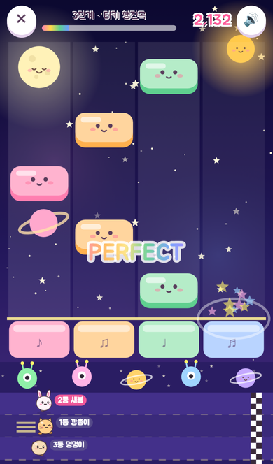
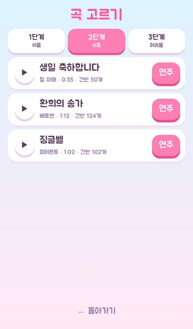
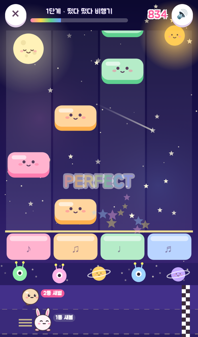
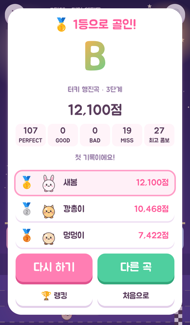

# 봄별 피아노 달리기 🎹🏃

새봄이·새별이와 함께 만든 리듬 게임입니다.
위에서 내려오는 귀여운 건반을 박자에 맞춰 톡! 잘 맞출수록 화면 아래 내 캐릭터가 쌩쌩 달려서 친구와 경주해요.

| 처음 화면 | 봄이 무대 | 별이 무대 |
|---|---|---|
|  |  |  |

| 곡 고르기 | 친구랑 경주 | 결과 |
|---|---|---|
|  |  |  |

## 무엇이 들어 있나

- **건반 판정**: 선에 닿을 때 누르면 PERFECT / GOOD / BAD / MISS. PERFECT·GOOD 이 이어지면 COMBO! 10콤보마다 관중이 응원해요.
- **긴 건반**: 별이 달린 긴 건반은 꾹 누르고 있다가 별이 선에 오면 손을 떼요.
- **달리기 경주**: 맞출수록, 콤보가 클수록 아래 캐릭터가 빨라져요. 혼자 할 때는 토끼 "깡총이", 강아지 "멍멍이"와 겨뤄요.
- **함께하기**: 4자리 방 번호로 들어오면 방장이 고른 곡을 동시에 연주하며 경주해요. 서로 달리는 모습이 보여요.
- **음악**: 건반을 맞추면 멜로디가 피아노로 연주되고, 뒤에는 드럼·베이스·화음 반주가 신나게 깔려요. 두 번째 반복은 더 신나게! (모두 코드로 만든 소리)
- **곡** (모두 저작권이 끝난, 누구나 아는 곡)
  - 1단계 쉬움: 작은 별 · 떴다 떴다 비행기 · 나비야
  - 2단계 보통: 생일 축하합니다 · 환희의 송가 · 징글벨
  - 3단계 어려움: 미뉴에트 G장조 · 엘리제를 위하여 · 터키 행진곡
- **무대**
  - 봄이 무대: 해님, 바람에 날리는 꽃잎, 나비, 응원하는 토끼·강아지·병아리·고양이
  - 별이 무대: 잠자는 달님, 해님, 고리 행성, 별똥별, 콤보 때 지나가는 UFO, 응원하는 외계인·행성 친구들
- **캐릭터 7종**: 토끼, 고양이, 병아리, 곰, 개구리, 펭귄, 강아지
- **랭킹**: 곡별 최고 점수, 누적 점수
- 컴퓨터에서는 D F J K 키로도 칠 수 있어요.

## 내 컴퓨터에서 실행

```bash
cd piano-run
npm install
npm run dev
```

- **혼자 연주**와 **이 기기 랭킹**은 아무 설정 없이 동작합니다.
- 주소 끝에 `?local=1`을 붙이면 같은 브라우저의 탭끼리 경주를 해 볼 수 있습니다 (테스트용).

## 인터넷에 올리기 (슬라임 게임과 같은 방법)

1. **Supabase**: 슬라임 게임에서 쓰는 프로젝트의 SQL Editor에서 `supabase/piano.sql`을 한 번 Run
2. **Cloudflare Pages**: Workers 및 Pages → 만들기 → Pages → Git 연결 → `po3`
   - 프로덕션 분기: 게임이 있는 브랜치
   - 빌드 명령 `npm run build`, 출력 디렉터리 `dist`, 루트 디렉터리 **`piano-run`**
   - 환경 변수: `VITE_SUPABASE_URL`, `VITE_SUPABASE_ANON_KEY` (슬라임 게임과 같은 값), `NODE_VERSION` = `22`

## 곡 추가하기

`src/songs.js`의 `SONGS`에 멜로디를 적으면 건반 악보가 자동으로 만들어집니다.

```js
melody: `C5:1 C5:1 G5:1 G5:1 | A5:1 A5:1 G5:2`, // 음이름옥타브:박자, R = 쉼표
chords: 'C C F C',                              // 반주 화음
```

멜로디가 올라가면 오른쪽 건반, 내려가면 왼쪽 건반으로 배치되고, 0.75초 이상 긴 음은 꾹 누르는 건반이 됩니다.

## 폴더 구성

```
piano-run/
├─ src/
│  ├─ main.js     화면 전환, 곡 고르기, 경주 방, 결과, 랭킹
│  ├─ game.js     연주 화면 (건반, 판정, 콤보, 달리기 경주)
│  ├─ songs.js    곡 악보와 건반 배치
│  ├─ music.js    반주·피아노 소리·효과음
│  ├─ scene.js    봄이 무대 / 별이 무대, 관중
│  ├─ chars.js    캐릭터
│  ├─ net.js      친구랑 경주 (Supabase Realtime)
│  └─ rank.js     랭킹 저장
└─ supabase/piano.sql
```
