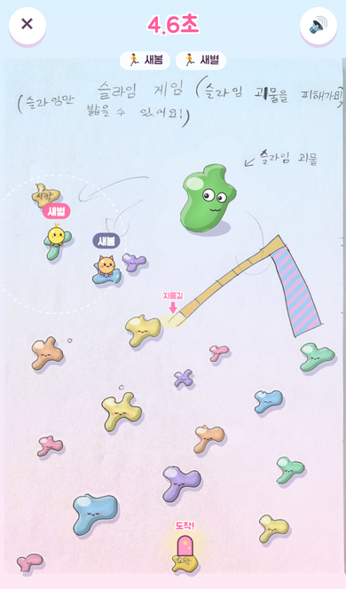
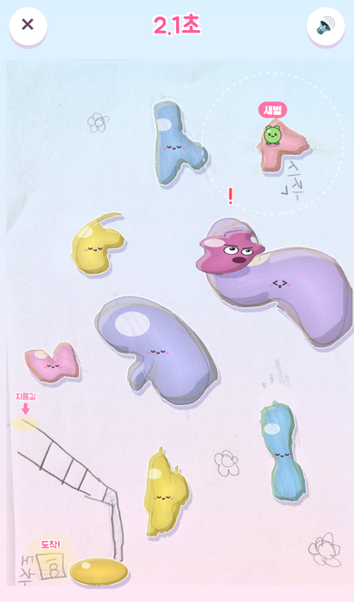
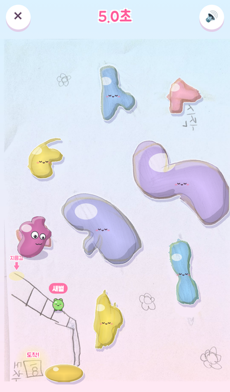

# 슬라임 게임 🟢

새봄이와 새별이가 그린 그림으로 만든 휴대폰 게임입니다.
슬라임 구름을 톡톡 뛰어 건너며 **슬라임 괴물을 피해 문까지** 가면 성공!

| 처음 화면 | 새봄이 맵 (친구랑 경주) | 새별이 맵 |
|---|---|---|
|  |  |  |

| 사다리 지름길 | 경주 방 | 결과 |
|---|---|---|
|  |  |  |

## 무엇이 들어 있나

- **두 개의 맵**: 새봄이 그림(슬라임 숲, 미끄럼틀 지름길), 새별이 그림(구름 하늘, 사다리 지름길)
  - 아이들이 그린 구름을 하나하나 잘라 내서 말랑한 젤리 슬라임으로 색칠했습니다. 밟으면 출렁이고, 친구가 올라서면 눈을 떠요.
  - 몇몇 구름은 천천히 움직여서 타이밍을 맞춰야 해요.
- **슬라임 괴물**: 새봄이가 그린 괴물이 그대로 살아서 통통 뛰어다닙니다. 눈은 내 캐릭터를 쳐다보고, 멀리 뛰기 전에는 화난 눈썹과 ❗가 떠요. 닿으면 냠! 처음부터.
- **지름길**: 🪜 표시에 내리면 사다리를 올라가 미끄럼틀로 슝 내려가 멀리 날아갑니다.
- **캐릭터 6종**: 토끼, 고양이, 병아리, 곰, 개구리, 펭귄
- **친구랑 경주**: 4자리 방 번호로 여러 폰이 같은 맵에서 동시에 달립니다. 서로의 캐릭터가 화면에 보이고, 먼저 도착한 순서대로 🥇🥈🥉.
- **점수·랭킹**: 성공하면 점수(기본 100 + 빠를수록 보너스 + 경주 등수 보너스). 맵별 최고 기록과 누적 점수 랭킹.
- **소리**: 귀여운 반복 멜로디, 점프·착지·떨어짐·괴물·먹힘·사다리·미끄럼틀·도착 효과음 (모두 코드로 만든 소리라 음악 파일 없음)
- 휴대폰 홈 화면에 추가하면 앱처럼 전체 화면으로 열립니다.

## 하는 법

1. 이름을 쓰고 캐릭터와 맵을 고릅니다.
2. **구름을 톡 누르면** 그쪽으로 뜁니다. 점선 동그라미 안까지만 뛸 수 있어요.
3. 구름 밖으로 뛰면 떨어져서 원래 구름으로 돌아갑니다.
4. 괴물에게 닿으면 처음 자리로 돌아갑니다. 괴물이 쉬는 동안 지나가세요!
5. 문(도착)에 닿으면 성공!

## 내 컴퓨터에서 실행

```bash
cd slime-game
npm install
npm run dev
```

화면에 나오는 주소를 열면 됩니다. 같은 와이파이의 휴대폰에서는 `Network:` 주소로 열 수 있어요.

- **혼자 하기**와 **이 기기 랭킹**은 아무 설정 없이 동작합니다.
- 주소 끝에 `?local=1`을 붙이면 **같은 브라우저의 탭끼리** 경주를 해 볼 수 있습니다 (테스트용).

## 인터넷에 올리기 (무료)

### 1. Supabase 설정 (친구랑 경주 + 모두의 랭킹)

채팅사이트에서 쓰는 Supabase 프로젝트를 그대로 써도 됩니다. 테이블 이름이 달라서 서로 영향이 없습니다.

1. Supabase 대시보드 → **SQL Editor** → **New query**
2. `supabase/slime.sql` 내용을 전부 붙여넣고 **Run** (한 번만)
3. **Project Settings → API**에서 Project URL과 anon(publishable) 키를 확인합니다.

경주는 Supabase **Realtime**(기본으로 켜져 있음)으로 주고받아서 따로 켤 것은 없습니다.

### 2. Cloudflare Pages 배포

1. Cloudflare 대시보드 → **Workers & Pages → Create → Pages → Connect to Git** → 이 저장소 선택
2. 빌드 설정
   - Root directory: `slime-game` (게임이 저장소 맨 바깥에 있으면 비워 둠)
   - Build command: `npm run build`
   - Build output directory: `dist`
3. Environment variables
   - `VITE_SUPABASE_URL` = Project URL
   - `VITE_SUPABASE_ANON_KEY` = anon(publishable) 키
   - `NODE_VERSION` = `22`
4. **Save and Deploy** → `https://<이름>.pages.dev` 주소를 아이들 폰에서 열면 끝!

Supabase 값을 넣지 않으면 혼자 하기와 이 기기 랭킹만 동작합니다.

## 그림 바꾸기

`art/` 폴더의 사진이 원본입니다. 사진을 바꾸거나 색을 바꾸려면 `tools/process_drawings.py`를 고친 뒤 실행하세요.

```bash
pip install pillow numpy scipy
python3 tools/process_drawings.py
```

`public/maps/<맵>/` 안의 배경(`bg.jpg`), 구름(`c*.png`), 괴물(`monster.png`), 미리보기(`thumb.jpg`), 맵 정보(`map.json`)가 새로 만들어집니다.

## 폴더 구성

```
slime-game/
├─ art/                 아이들 그림 원본 사진
├─ tools/               그림 → 게임 이미지 변환
├─ public/maps/         맵별 배경·구름·괴물 이미지와 map.json
├─ src/
│  ├─ main.js           화면 전환, 경주 방, 결과, 랭킹 화면
│  ├─ game.js           게임 화면 (점프, 떨어짐, 괴물, 지름길, 효과)
│  ├─ monster.js        괴물 움직임 (경주하는 모든 폰에서 똑같이)
│  ├─ map.js            맵 불러오기, 밟을 수 있는지 판정
│  ├─ chars.js          캐릭터 그리기
│  ├─ audio.js          음악·효과음
│  ├─ net.js            친구랑 경주 (Supabase Realtime / 탭끼리 테스트)
│  └─ rank.js           점수·랭킹 저장
└─ supabase/slime.sql   랭킹 테이블
```
