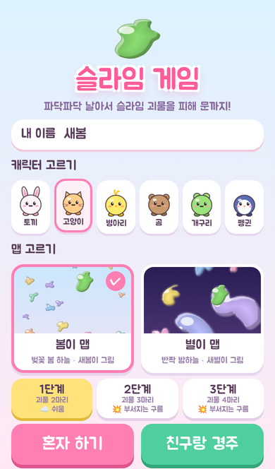
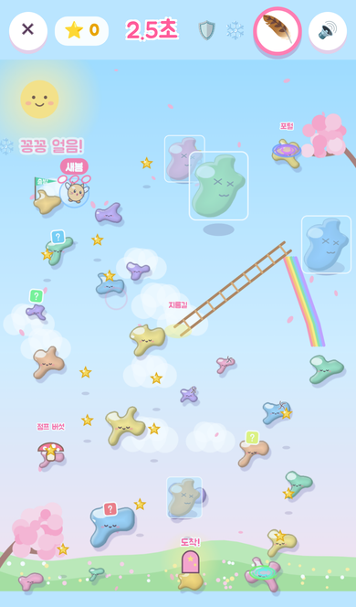
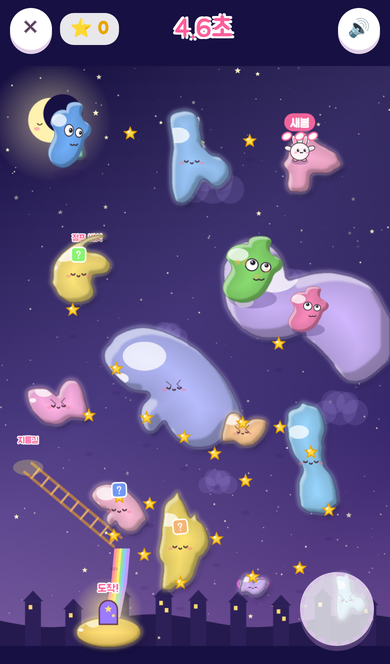
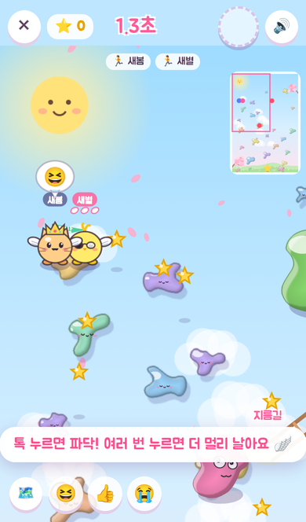
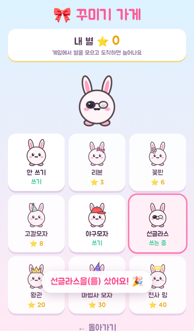
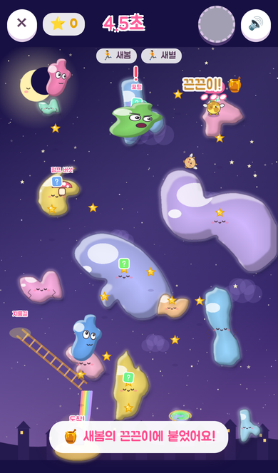
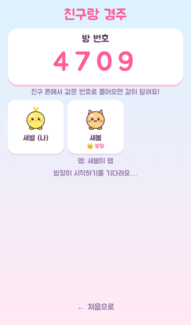
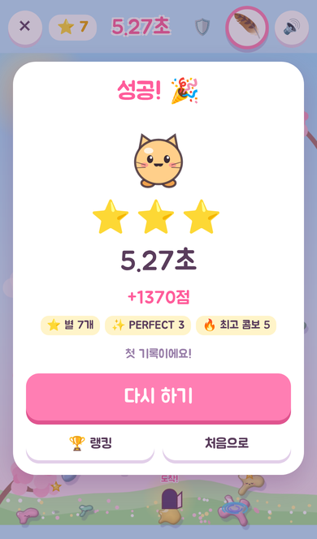

# 슬라임 게임 🟢

새봄이와 새별이가 그린 그림으로 만든 휴대폰 게임입니다.
날개를 파닥파닥 움직여 슬라임 구름을 건너며 **슬라임 괴물들을 피해 문까지** 가면 성공!

| 처음 화면 | 봄이 맵 (3단계, 얼음 아이템) | 별이 맵 |
|---|---|---|
|  |  |  |

| 가까이 보기 + 미니맵 + 이모티콘 | 꾸미기 가게 | 친구랑 경주 (끈끈이!) |
|---|---|---|
|  |  |  |

| 경주 방 | 결과 |
|---|---|
|  |  |

## 무엇이 들어 있나

- **두 개의 맵**: 아이들이 그린 구름 모양과 위치를 그대로 살려 젤리 슬라임으로 다시 그렸습니다.
  - **봄이 맵** (새봄이 그림): 해님이 웃고 벚꽃잎이 날리는 봄 하늘
  - **별이 맵** (새별이 그림): 잠자는 초승달, 반짝이는 별, 별똥별이 지나가는 밤하늘
  - 아이 그림의 구름 모양을 빌려 만든 새 발판도 추가했습니다. 몇몇 구름은 천천히 움직입니다.
- **날개 조작**: 가고 싶은 곳을 톡 누르면 파닥! 날면서 또 누르면 더 높이 더 멀리 (한 번에 3번까지). 누르기를 멈추면 내려앉아요.
- **슬라임 괴물 여러 마리**: 새봄이가 그린 괴물이 초록·분홍·파랑·주황·보라 5가지 색, 여러 크기로 나옵니다. 작은 괴물은 더 빨라요. 멀리 뛰기 전에 ❗ 경고. 높이 날면 괴물 위로 지나갈 수 있어요.
- **지름길 3가지**: 🛝 사다리 → 무지개 미끄럼틀, 🌀 순간이동 포털, 🍄 점프 버섯
- **아케이드 재미**
  - ⭐ 하늘에 떠 있는 별 모으기
  - ❓ 아이템 상자 → 룰렛 → 🛡️ 방패 · 🪶 무한 날개 · ❄️ 꽁꽁 얼음(괴물 정지) · 🧲 별 자석 · ⚡ 번개 날개 · 🍯 끈끈이(경주 때 1등에게 발사!)
  - ✨ 구름 한가운데 내리면 PERFECT, 계속 성공하면 콤보
  - 💥 2·3단계는 밟으면 부서지는 금 간 구름
- **1·2·3단계**: 괴물 2·3·4마리, 단계가 높을수록 점수 보너스. 성공하면 "다음 단계" 버튼.
- **캐릭터 6종**: 토끼, 고양이, 병아리, 곰, 개구리, 펭귄 (모두 날개를 달고 날아요)
- **가까이 보기**: 화면이 내 캐릭터를 따라다니며 크게 보여줘요. 출발 전에는 맵 전체를 보여주다가 쭉 다가가요. 🗺️ 버튼으로 전체 보기와 바꿀 수 있고, 오른쪽 위 미니맵에 나·친구·괴물·문이 보여요.
- **🎀 꾸미기 가게**: 게임에서 모은 별(도착 보너스 포함)로 리본, 꽃핀, 고깔모자, 야구모자, 선글라스, 왕관, 마법사 모자, 천사 링을 사서 써요. 경주할 때 친구 화면에도 보여요.
- **경주 이모티콘**: 😆 👍 😭 버튼을 누르면 내 머리 위에 말풍선이 떠요.
- **친구랑 경주**: 4자리 방 번호로 여러 폰이 같은 맵·같은 괴물 움직임으로 동시에 달립니다. 서로 나는 모습이 보이고, 도착 순서대로 🥇🥈🥉.
- **점수·랭킹**: 시간 + 별 + PERFECT + 콤보 + 등수 보너스. 맵·단계별 최고 기록과 누적 점수 랭킹.
- **소리**: 귀여운 반복 멜로디와 날개짓·별·아이템·괴물·포털·버섯 등 효과음 (모두 코드로 만든 소리)

## 하는 법

1. 이름, 캐릭터, 맵, 단계를 고릅니다.
2. **가고 싶은 곳을 톡** 누르면 날개를 파닥이며 날아갑니다. 날면서 **또 누르면** 더 멀리!
3. 누르기를 멈추면 내려앉아요. 구름 밖에 내리면 떨어져서 원래 구름으로 돌아갑니다.
4. 괴물에게 닿으면 처음 자리로. 아이템 상자를 먹으면 위쪽 아이템 버튼을 눌러 쓰세요.
5. 문(도착)에 닿으면 성공!

## 내 컴퓨터에서 실행

```bash
cd slime-game
npm install
npm run dev
```

화면에 나오는 주소를 열면 됩니다. 같은 와이파이의 휴대폰에서는 `Network:` 주소로 열 수 있어요.

- **혼자 하기**와 **이 기기 랭킹**은 아무 설정 없이 동작합니다.
- 주소 끝에 `?local=1`을 붙이면 **같은 브라우저의 탭끼리** 경주를 해 볼 수 있습니다 (테스트용).

## 인터넷에 올리기 (무료)

### 1. Supabase 설정 (친구랑 경주 + 모두의 랭킹)

채팅사이트에서 쓰는 Supabase 프로젝트를 그대로 써도 됩니다. 테이블 이름이 달라서 서로 영향이 없습니다.

1. Supabase 대시보드 → **SQL Editor** → **New query**
2. `supabase/slime.sql` 내용을 전부 붙여넣고 **Run** (한 번만)
3. **Project Settings → API**에서 Project URL과 anon(publishable) 키를 확인합니다.

경주는 Supabase **Realtime**으로 주고받습니다. 기본으로 켜져 있어서 보통은 따로 켤 것이 없습니다.
다만 **Project Settings → Realtime**에서 "Allow public access"가 꺼져 있거나 "Private channels only"가 켜져 있으면 경주 방에 들어가지 못하니, 공개 채널을 허용해 주세요.

### 2. Cloudflare Pages 배포

1. Cloudflare 대시보드 → **Workers & Pages → Create → Pages → Connect to Git** → 이 저장소 선택
2. 빌드 설정
   - Root directory: `slime-game` (게임이 저장소 맨 바깥에 있으면 비워 둠)
   - Build command: `npm run build`
   - Build output directory: `dist`
3. Environment variables
   - `VITE_SUPABASE_URL` = Project URL
   - `VITE_SUPABASE_ANON_KEY` = anon(publishable) 키
   - `NODE_VERSION` = `22`
4. **Save and Deploy** → `https://<이름>.pages.dev` 주소를 아이들 폰에서 열면 끝!

Supabase 값을 넣지 않으면 혼자 하기와 이 기기 랭킹만 동작합니다.

## 그림 바꾸기

`art/` 폴더의 사진이 원본입니다. 사진을 바꾸거나 색을 바꾸려면 `tools/process_drawings.py`를 고친 뒤 실행하세요.

```bash
pip install pillow numpy scipy
python3 tools/process_drawings.py
```

`public/maps/<맵>/` 안의 구름(`c*.png`), 괴물 5색(`monster-*.png`), 미리보기(`thumb.jpg`), 맵 정보(`map.json`: 구름 위치, 지름길, 문)가 새로 만들어집니다. 배경 하늘은 `src/background.js`가 그립니다.

## 폴더 구성

```
slime-game/
├─ art/                 아이들 그림 원본 사진
├─ tools/               그림 → 게임 이미지 변환
├─ public/maps/         맵별 구름·괴물 이미지와 map.json
├─ src/
│  ├─ main.js           화면 전환, 경주 방, 결과, 랭킹 화면
│  ├─ game.js           게임 화면 (날개 비행, 괴물, 지름길, 별, 아이템, 효과)
│  ├─ background.js     봄 하늘 · 밤하늘 배경
│  ├─ monster.js        괴물 움직임 (경주하는 모든 폰에서 똑같이)
│  ├─ map.js            맵 불러오기, 밟을 수 있는지 판정
│  ├─ chars.js          캐릭터 그리기
│  ├─ audio.js          음악·효과음
│  ├─ net.js            친구랑 경주 (Supabase Realtime / 탭끼리 테스트)
│  ├─ rank.js           점수·랭킹 저장
│  └─ store.js          브라우저 저장소 (막혀 있어도 동작)
└─ supabase/slime.sql   랭킹 테이블
```
